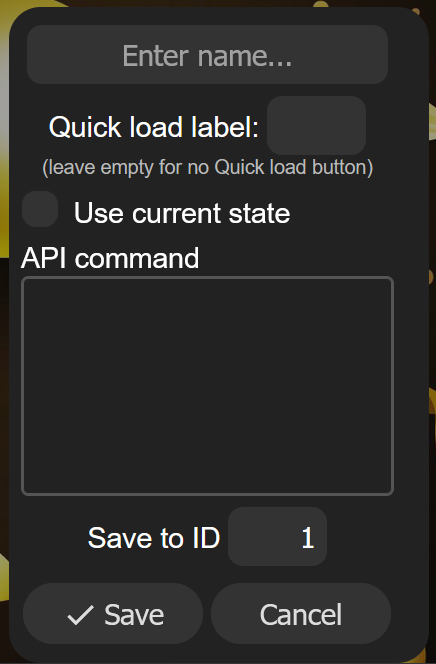

# WLED Presets and Configuration

[WLED](https://kno.wled.ge) presets I want to keep in source control

As a personal convention, if a preset is prefixed with `///`, it has segment-specific settings I want to keep.

* [Office shelves](./office-shelves.json)
* [Roof line](./roof-line.json)

## Usage

Copy a line from the json into a new preset in your WLED dashboard.

In the new Preset window, uncheck "Use current state" and paste in the value. Skip the "0"/"1"/"2" prefix in the JSON file - that's the ID.

## Layered presets (WLED 16+)

Some roof presets (e.g. `Christmas • … v2`, `111`–`117`) use WLED 16 segment layering: full-length segments stacked on top of each other, with a per-segment blend mode (`bm`) and opacity (`bri`). Later segments render on top. These require WLED 16 or newer.

## Home Assistant

I use Home Assistant automations to enable holiday-specific presets/playlists based on the day. Details are in the [Home Assistant Configuration](./home-assistant.md) doc.

## Todo?

- [ ] Add a script to automatically pull the json files from my WLED instances into this repo
- [ ] Add a script to automatically format the json files, stripping unnecessary info (LED counts, etc.)
